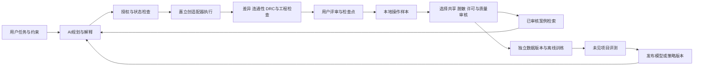

# 对话式PCB协作架构草案

## 执行边界

模型不直接把未知工程当作旧案例重放。每次先识别项目、文档、板框、层叠、器件/封装/网络和已有规则，再对当前快照生成差异。写入前比较状态版本；并行人工编辑、失联或结果不一致时先恢复一致状态。

适配器应提供稳定的“读取—生成候选—检查—提交—保存”接口。现有嘉立创API桥接能力可作为研究起点，第三方工具的许可、版本和能力需单独确认；不能把当前客户端缺少的API当作已经支持。

授权应表达为操作范围，例如“允许走线和移动，禁止改网络/删件”；用户后来明确授权改网时更新范围并留下证据。不要把普通文件中的文字当作用户授权。

## 数据存储

- 初期采用版本化的JSON/JSONL事件与文件清单，配合本地索引，便于审查和迁移。
- 后续将结构化元数据放关系型存储，大型CAD/截图/报告放对象存储，检索索引只存合适的摘要与引用。
- 不把所有原生CAD二进制、聊天长文和截图简单塞入同一张向量表；文件用哈希、类型和版本关联。
- 每个事件引用精确的前后状态和模型/工具版本；候选、已执行、已撤回与最终接受必须可区分。

## 三种“改进”分别计量

1. 提示和检索：相关案例命中、建议适用性、用户纠错次数、完成任务时间。
2. 规划和执行工具：约束违规、状态冲突阻断、回滚可靠性、独立检查通过率。
3. 路由能力：必须连接的网络完成情况、不同网短接、间距及制造约束、关键回路/电源路径质量，而不是只比线长或DRC总数。

## 验证优先级

先检查禁止修改的内容和授权范围，再检查网络正确、短路及设计规则；大电流铜颈/过孔/回流等需要电气依据，不能由普通DRC代替。工作条件未知时标为“未评估”，不能自动当作通过。

评价应保留完整DRC类型与对象、检查器版本和规则配置。导入后规则被关闭导致的低错误数不是改进。未布线阶段允许的连接错误和已完成线路中的断网是不同问题。

## MVP推进顺序

1. 定义任务、状态、授权和样本格式；整理少量高质量成功、失败与人工修正案例。
2. 实现嘉立创只读快照、修改前后差异、检查点和本地采集。
3. 接入受控的局部操作与独立验证；支持人工确认方案及结果撤回。
4. 做案例检索和任务评测，再开放选择性贡献。
5. 样本质量、规模与评测成熟后，才规划具体模型训练和训练成本。
